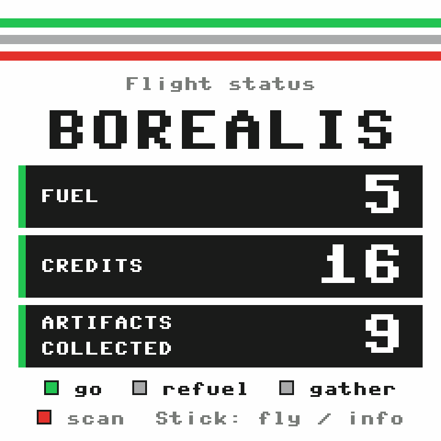

# Starproof for Wedgie

The installable hardware signer for [Starproof](https://starproof-wedgie.vercel.app), a space exploration game. Launch always requires a manufacturer-certified OPTIGA Trust M signature. The browser’s **Demo admin settings** independently toggle Wedgie confirmation for travel, artifact collection, refuelling and scavenging; all four default to on. Fuel uses an 8-unit tank and distance-based jumps costing 2–8. A free cache at each planet fills the tank once; later refills cost 4 game credits. Scavenging gathers up to 2 fuel for free.

Browser game: [NikolaiL/starproof](https://github.com/NikolaiL/starproof). Shared toolkit: [wedgie-actions](https://github.com/NikolaiL/wedgie-actions).

Version 0.5.0 validates all 20 destinations and their distance-priced routes, adds browser navigation controls, and displays live game stats. The new charts found on Kepler, Lyra, Cinder, Moss and Borealis are shown with artifact rewards. Connect from the game to update older device apps; existing mission progress stays on the server.

## Dashboard preview

Rendered preview of the 240×240 device screen using the MicroPython bitmap font, enlarged for readability. The dashboard shows browser-supplied game stats.

## Hardware airdrop proof

Version 0.5.0 adds `starproof_wallet` (read-only Safe public-key discovery) and `starproof_airdrop` (a two-page, physically approved wallet/factory proof) while Starproof stays running. The claim is fixed to STARPROOF on Base and 1,000 tokens. Review the token contract, then the full receiving Safe address. The browser can cancel either page.

The app requires an already initialized and locked Safe key. It never creates, replaces or locks that key, never calls Safe Signer’s startup helper, and writes no Safe metadata. The airdrop contract and funded backend are configured separately; installing this version does not make a claim available by itself. Host tests cover the proof path; physical RAM and display behavior still need checking.

## Install through wedgie.dev

1. Connect your Wedgie in desktop Chrome or Edge at [wedgie.dev/connect](https://wedgie.dev/connect).
2. Open **Apps from a GitHub repo** and add **`NikolaiL/wedgie-starproof`**.
3. Select **Starproof**, review the source, then press the physical green button to install.
4. Close that connection and open [Starproof](https://starproof-wedgie.vercel.app).

**Current wedgie.dev installer issue:** its signed-app fallback can reject community repos with “the wedgie didn’t take it” before any files are copied. If that happens, use **Connect Wedgie** in [Starproof](https://starproof-wedgie.vercel.app), which installs this pinned app after physical approval, or use the official CLI. A small proposed upstream fix is included in [docs/wedgie-dev-community-install.patch](docs/wedgie-dev-community-install.patch); it preserves physical full-control approval for unreviewed apps and does not alter signed installs. It has not been submitted upstream or tested in their full website.

Requires firmware **0.3.76+**, a 240×240 display and an **OPTIGA Trust M** chip. This is a community app, not a reviewed Wedgie shelf app. Installation selects Starproof as the running app and requires full-control approval on the device. Review [wedgie.json](wedgie.json) and [device/](device/) before installing.

For CLI installation, clone this repository and run `python3 /path/to/wedgie.py install .`. Obtain the official CLI from [wedgie.dev](https://wedgie.dev/wedgie.py); it needs `pyserial`.

## Controls and screens

- **Navigation:** joystick flies; its press toggles the selected planet’s info popup. Green launches or travels to the selected planet; the second button refuels; the third scavenges; red scans the nearest planet. Shortcuts follow the browser’s confirmation switches.
- **Signing prompt:** green approves the displayed action; red declines. A navigation press can open a signing prompt but cannot approve it; press green again after reviewing the device screen.
- The idle dashboard has a large planet heading and three high-contrast cards for fuel, credits and artifacts collected, with large numeric totals. These are browser-supplied game telemetry, not trusted signing labels. Navigation pauses inside signing prompts and stops after a missed browser heartbeat.
- Travel previews show the destination planet, source and fuel cost.
- Artifact previews show the relic, credits and map rewards.
- Refills show a free cache or the exact credit price.
- Cancelling in the browser dismisses the device prompt without signing.

Only real physical presses can approve; USB can cancel but cannot approve. The app reads the existing factory certificate and signs with the existing factory key. It creates/replaces/locks no keys and does not write Safe Signer's key slots. It accepts only Starproof's pinned production origin or localhost demo ports. This proves chip participation, not firmware attestation or human presence.

## Develop

`npm ci && npm test` checks Python parsing, physical-only cancellation, artwork bounds and vendored helper provenance. Node 24+ and Python 3 are required on the development computer; the installed app uses MicroPython. Run `npm run sync:device` after deliberately upgrading `wedgie-actions`. Artwork is procedural and needs no extra device assets.

MIT. Built with AI assistance during ETHGlobal Mumbai Classic, November 6, 2026. Wedgie firmware supplies `ui`, `lcd`, `wedgie` and `optiga`; the common helper is vendored from `wedgie-actions`.
